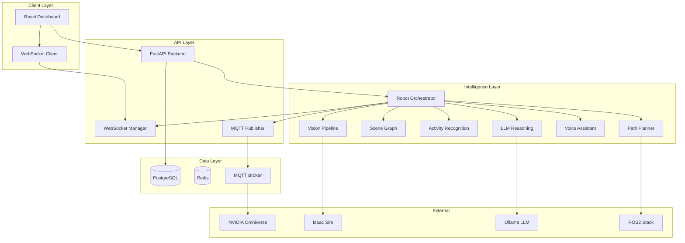

# Architecture

## System Overview

SceneMind AI follows a **microservices-inspired modular architecture** with a central orchestrator coordinating perception, reasoning, navigation, and voice subsystems.

## Component Diagram

## Data Flow

### Perception Pipeline (30 FPS)

1. **Camera Frame** → YOLOv11 Object Detection
2. **Detections** → Scene Graph Builder (spatial relationships)
3. **Detections** → Activity Recognizer (human activities)
4. **Scene Context** → LLM Reasoning (natural language description)
5. **Description** → Voice Synthesis (Piper TTS)
6. **All State** → WebSocket Broadcast + MQTT Publish + Database Persist

### Voice Interaction

1. User speaks → Whisper STT transcription
2. Intent classification → Route to appropriate handler
3. LLM generates response using scene context
4. Piper TTS synthesizes speech
5. Response displayed on dashboard + spoken aloud

### Navigation

1. Goal received → Path Planner (A*/Dijkstra/RRT)
2. LLM explains route selection
3. Path published to ROS2 Nav2 + Digital Twin
4. Dynamic replanning on obstacle detection

## Design Principles

- **SOLID** — Single responsibility per module, dependency injection via orchestrator
- **Simulation-first** — All modules work without hardware via simulation mode
- **Event-driven** — WebSocket + MQTT for real-time state propagation
- **Graceful degradation** — Template fallbacks when Ollama/GPU unavailable
