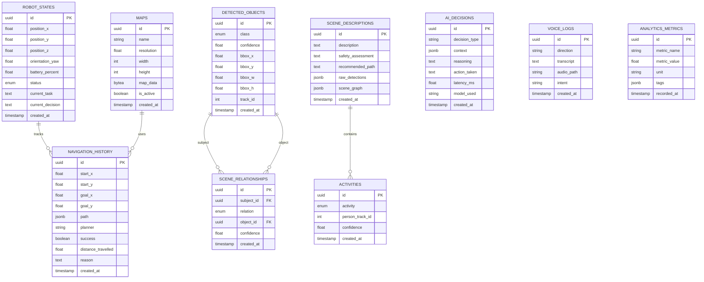

# Database Schema

## Entity Relationship Diagram

## Tables Summary

| Table | Records | Purpose |
|-------|---------|---------|
| `robot_states` | Time-series | Robot position, battery, status snapshots |
| `detected_objects` | Per-frame | YOLO detection results |
| `scene_relationships` | Per-frame | Spatial graph edges |
| `scene_descriptions` | Per-analysis | LLM-generated scene text |
| `activities` | Per-frame | Recognized human activities |
| `navigation_history` | Per-mission | Path planning records |
| `ai_decisions` | Per-decision | LLM reasoning audit trail |
| `voice_logs` | Per-interaction | STT/TTS transcripts |
| `maps` | Per-map | SLAM occupancy grids |
| `analytics_metrics` | Time-series | Performance KPIs |
| `user_activity` | Per-action | Dashboard usage tracking |

Schema initialization: `database/init.sql`
